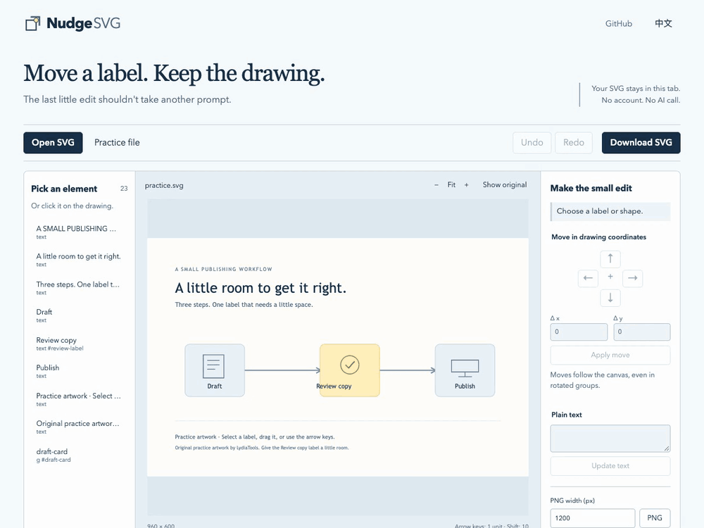

# NudgeSVG

**Stop prompting for the last 3 pixels.**

Move a label. Fix a few words. Keep the rest of your SVG source exactly as it was.

[Open the editor](https://lydiatools.github.io/nudgesvg/) · [Chinese](README.zh-CN.md) · [Download the offline kit](https://github.com/LydiaTools/nudgesvg/releases/tag/v0.1.1)



Real editor capture: move **Review copy** by `+40` SVG units, compare the original, inspect the one changed source range, then download SVG. [Still screenshot](docs/assets/editor-en.png).

The drawing is almost right. The label is a little too far left. Another prompt might fix it—or move something else you liked.

I wanted a small finishing tool: open a static SVG, point at the thing, make the edit, and see precisely which source fragments changed. No model key, account or installation.

## Try it in 30 seconds

1. [Open NudgeSVG](https://lydiatools.github.io/nudgesvg/). The practice drawing is already there.
2. Select **Review copy** on the drawing or in the element list.
3. Enter `40` in **Δ x**, then **Apply move**. The label moves into the centre of its card.
4. Inspect the single changed `transform` below the canvas. **Show original** switches the preview back without discarding the edit.
5. **Download SVG** to keep the editable vector, or **PNG** for an image.

For your own drawing, choose **Open SVG** or paste its markup below the editor. Nothing is sent to an AI service. An image flattened to PNG does not contain editable SVG labels.

**Already generating diagrams?** [Finish a label in a Pele SVG](docs/PELE.md): a pinned renderer, downloadable before/after files, and a one-range change record. The garden example uses Pele 1.7.0; it is a manual finishing workflow.

## What's different about this little tool?

- **Source-range edits.** Only the chosen text content or `transform` attribute is replaced. The SVG download is not passed through an XML serializer. Unedited characters, comments, quotes and line endings stay in place.
- **Moves follow the drawing.** Arrow keys move by one root SVG unit; Shift moves ten. Rotated/scaled parents are accounted for instead of turning “right” into a diagonal.
- **A change record you can inspect.** Download JSON with input/output SHA-256, literal before/after source fragments and their ranges. It records the edit, not whether the design looks better.
- **Direct manipulation.** Drag, nudge, change a plain text label, undo/redo, zoom and compare with the original.
- **Three useful downloads:** editable SVG, a raster PNG, and a change JSON. The JSON contains edited source fragments and is not a self-contained drawing or an automatic replay format.
- **English and Chinese.** Switch the interface; your artwork's words remain your words.

## Run offline

Download the [v0.1.1 ZIP](https://github.com/LydiaTools/nudgesvg/releases/tag/v0.1.1), unzip it, and open **`app/index.html`** in Chrome. The four application files stay together. This direct-file path has been tested, including an actual SVG edit and download.

Or, with Node.js 20+:

```sh
git clone https://github.com/LydiaTools/nudgesvg.git
cd nudgesvg
npm start
```

Open `http://127.0.0.1:8841`. Running the editor needs no package installation; the server uses Node's built-in modules. SVGs are read in the tab, not uploaded to that server.

## What it preserves

For supported UTF-8 SVG, no edit means the downloaded SVG has the same bytes, including a UTF-8 BOM if present. After an edit, only the recorded source ranges change. The receipt uses **JavaScript UTF-16 code-unit offsets**, not byte offsets; hashes cover the full UTF-8 input and output.

Existing geometry is kept. This is a small finishing tool: there is no path drawing, recolouring, automatic layout, font embedding or repair of broken SVG. A PNG export is a browser rasterization at the chosen width; font appearance depends on fonts installed on the device.

The tab holds the document in memory. There is no document autosave or cloud recovery. Download your work before closing; opening another file asks before replacing unexported edits. GitHub Pages serves the app's static files; application code contains no analytics or SVG-upload request.

## Supported files and limits

- UTF-8 static SVG with the SVG namespace and a positive `viewBox` or explicit pixel width/height.
- Common shapes, groups, paths, gradients, clipping, masks, local references and selected static filters. Up to **1 MiB**, **5,000 elements**; the list shows its first 300 eligible elements, while elements can also be selected on the canvas.
- Plain text editing requires a `<text>` element with one text node. A label containing `<tspan>` children can be moved but is not flattened into editable plain text.
- Scripts, event handlers, active SVG elements, `foreignObject`, embedded bitmap images, external resources, DTD/entities, non-UTF-8 declarations, animations and CSS transforms are rejected. SVG `transform` attributes are supported. Imported content is additionally isolated in a script-disabled preview frame.
- PNG width: **64–4,096 px**; maximum **16 million pixels**, maximum height 16,384 px. No batch uploads or hidden server conversion.
- Tested locally with Chrome 155 on macOS; CI separately exercises Chromium on Ubuntu. Other browser/device combinations are not claimed as tested. Desktop is the most comfortable way to make precise edits; the narrow layout includes zoom and element selection.

This is **v0.1.1, an early preview**. We have tested the stated cases, not the entire SVG specification. No real-user adoption or productivity gain is asserted. [Validation details](docs/VALIDATION.md)

## Why this exists alongside SVG editors

[SVG-Edit](https://github.com/SVG-Edit/svgedit) and [Method Draw](https://github.com/methodofaction/Method-Draw) already provide full drawing tools. Use them when you need paths, illustration tools and broader editing.

The public discussion in Anatomy [#124](https://github.com/wheresryan22/anatomy/issues/124) describes the frustration of repeated agent-directed position adjustments and a contributor's figure-specific editor. It helped sharpen this task. NudgeSVG's code, source-range patcher and practice artwork are independently written. This is a static-SVG finishing workflow; it does not edit Anatomy scenes, WebGL or interactive HTML figures.

## Development

```sh
npm test                       # Node built-ins; 7 source-range tests
npm ci                         # Development dependencies only
npm run test:pele               # Reproduce the pinned Pele example
npx playwright install chromium
BROWSER_CHANNEL=chromium npm run test:browser
```

On Windows, set `BROWSER_CHANNEL=chromium` using your shell's environment syntax before running the last command. With Chrome installed, the browser test defaults to that channel instead.

Browser checks use original synthetic drawings, actual file/PNG/JSON downloads, nested transforms, real pointer dragging, text escaping, unsupported inputs, language switching, mobile layout and direct `file://` opening. They do not call a model or prove external adoption. [Contributing](CONTRIBUTING.md)

If it helps you finish one of those almost-right diagrams, a Star is a useful way to keep it for the next one.

MIT © LydiaTools. The editor's four application files use no third-party libraries. Playwright (Apache-2.0) and the example renderer Pele (MIT) are development dependencies; generated SVG examples retain Pele's notice. [Third-party notes](THIRD_PARTY.md)
