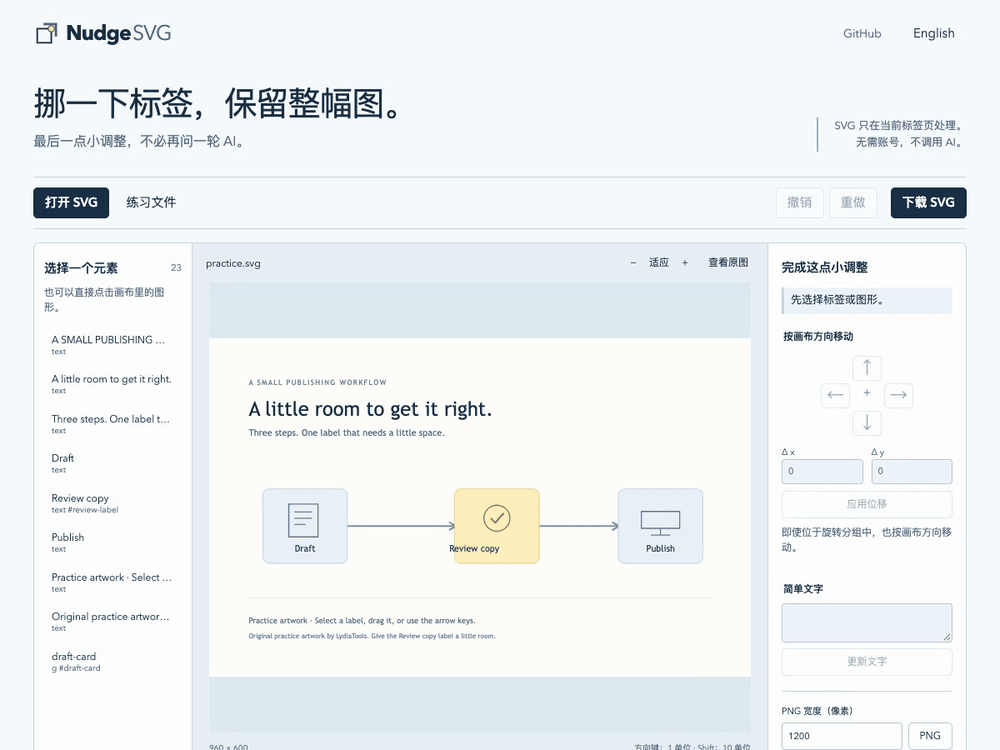

# NudgeSVG · SVG 微调工坊

**最后那几像素，不必再问一轮 AI。**

移动标签、修改几句话，其余 SVG 源码保持原样。

[在线打开](https://lydiatools.github.io/nudgesvg/?lang=zh) · [English](README.md) · [下载离线包](https://github.com/LydiaTools/nudgesvg/releases/tag/v0.1.0)



真实界面录屏：把 **Review copy** 向右移 `40` 个 SVG 单位，对照原图，核对唯一一处源码范围改动，再下载 SVG。[查看静态截图](docs/assets/editor-zh.png)。

图已经很接近了，偏偏一个标签靠左了一点。你可以继续解释，也可以直接把它挪到合适的位置。

我想做一个收尾工具：打开静态 SVG，选中元素，完成小调整，再明确看到到底改了哪几处源码。不需要模型密钥、账号或安装。

## 半分钟试一下

1. [打开中文版](https://lydiatools.github.io/nudgesvg/?lang=zh)，页面已带有练习图。
2. 点击图里的 **Review copy** 标签，也可在元素列表中选择。
3. 在 **Δ x** 输入 `40`，点击“应用位移”，标签就移到卡片中央。
4. 查看画布下方的 `transform` 改动。“查看原图”仅切换预览，不丢弃修改。
5. 下载 SVG 保留可编辑矢量文件，或下载 PNG 作为图片使用。

自己的图可通过“打开 SVG”或粘贴源码载入。PNG 已经是位图，不能用此工具修改里面的文字。

**已经用工具生成图了？** [试试 Pele SVG 标签微调](docs/PELE.zh-CN.md)：固定渲染版本、可下载的调整前后文件，以及只改一处源码的记录。园艺示例使用 Pele 1.7.0，演示生成后的手动收尾流程。

## 这个小工具的重点

- **只修改对应源码范围。** 替换选中文字或 `transform` 属性，不把整份 SVG 重新序列化；未改动的字符、注释、引号和换行保留。
- **按画布方向移动。** 方向键移动 1 个根 SVG 绘图单位，Shift 移动 10 个；嵌套旋转、缩放分组也按画布方向换算。
- **改动可核对。** JSON 包含原始/输出 SHA-256、修改前后片段和源码位置；它记录改动，不判断设计是否更好。它包含已修改的源码片段，不是完整图形或自动回放文件。
- **直接操作。** 拖拽、方向微调、改简单文字、撤销/重做、缩放、对照原图。
- **三种下载。** SVG、PNG、改动 JSON。
- **中英文界面。** 切换界面语言不会翻译或重写图里的文字。

## 离线使用

下载并解压 [v0.1.0 ZIP](https://github.com/LydiaTools/nudgesvg/releases/tag/v0.1.0)，保留 `app` 中的四个文件，在 Chrome 打开 **`app/index.html`** 即可。已实际验证这种直接打开方式及 SVG 编辑、下载。

也可以使用 Node.js 20+：

```sh
git clone https://github.com/LydiaTools/nudgesvg.git
cd nudgesvg
npm start
```

打开 `http://127.0.0.1:8841`。编辑器及本地静态服务器不需要安装 npm 依赖；SVG 由标签页读取，不上传给服务器。

## 保留范围与限制

支持 UTF-8 静态 SVG：根节点需带 SVG 命名空间，并有有效的 `viewBox` 或明确的像素宽高。未修改直接下载时保留原字节，包括 UTF-8 BOM；修改后只改变记录的源码范围。JSON 中位置按 **JavaScript UTF-16 代码单元**计数，不是字节偏移；哈希按完整 UTF-8 输入/输出计算。

- 常见形状、分组、路径、渐变、裁剪、蒙版、本地引用及部分静态滤镜；上限 **1 MiB、5,000 个元素**。列表最多显示前 300 个可选元素，仍可在画布上直接选取。
- 仅可修改含单一文本节点的 `<text>`；带 `<tspan>` 的复杂文字可移动，但不会被强行压平成简单文字。
- 拒绝脚本、事件处理、动态元素、`foreignObject`、嵌入位图、外部资源、DTD/实体声明、非 UTF-8 编码声明、动画和 CSS transform。支持 SVG `transform` 属性。预览另放在禁用脚本的隔离框架中。
- PNG 宽度 **64–4,096 像素**，总像素不超过 **1,600 万**，高度不超过 16,384 像素。字体由本机字体决定；不做字体嵌入、路径绘制、自动排版或 SVG 修复。
- 文件只保留在当前标签页内存中，没有云端恢复或文档自动保存。关闭前下载；有未导出改动时，打开新文件会询问是否替换。
- 本机测试为 macOS / Chrome 155，CI 另在 Ubuntu / Chromium 实跑。未宣称其他浏览器和设备都经过测试。精确操作更适合桌面端；窄屏提供缩放和元素列表。

这是 **v0.1.0 早期预览**，不是对完整 SVG 规范的覆盖。工程验证不代表已经有真实采用或效率提升。[验证记录](docs/VALIDATION.md)

## 与已有工具的关系

[SVG-Edit](https://github.com/SVG-Edit/svgedit)、[Method Draw](https://github.com/methodofaction/Method-Draw) 已有完整绘图功能，需要画路径和更广泛编辑时可使用它们。本工具专注少量改动及源码记录。

Anatomy [#124](https://github.com/wheresryan22/anatomy/issues/124) 的公开讨论描述了反复让 Agent 调位置的困难，贡献者也已做出适用于其单幅图形的编辑器。这个场景帮助我们明确任务。NudgeSVG 的代码、源码范围补丁器及练习图独立编写；不编辑 Anatomy 场景、WebGL 或带交互的 HTML 图形。

## 开发与验证

```sh
npm test
npm ci
npm run test:pele
npx playwright install chromium
BROWSER_CHANNEL=chromium npm run test:browser
```

Windows 请先用相应 Shell 语法设置环境变量；本机已安装 Chrome 时，浏览器测试默认使用 Chrome。7 项源码范围测试及真实浏览器流程使用原创合成图，包含下载文件、旋转分组、拖拽、文字转义、拒绝不支持输入、双语、手机与离线打开。不调用模型。[贡献说明](CONTRIBUTING.md)

如果它帮你收好了那张“差一点就对了”的图，可以 Star 留作下次使用。

MIT © LydiaTools。四个编辑器应用文件不依赖第三方运行库；Playwright 和示例渲染器 Pele 仅用于开发验证，生成的 SVG 示例保留 Pele 许可声明。[第三方说明](THIRD_PARTY.md)
