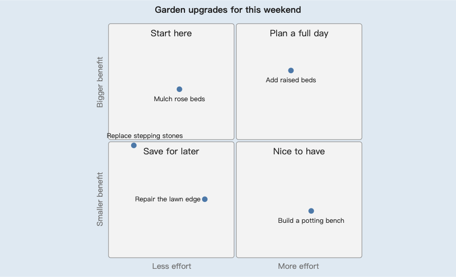
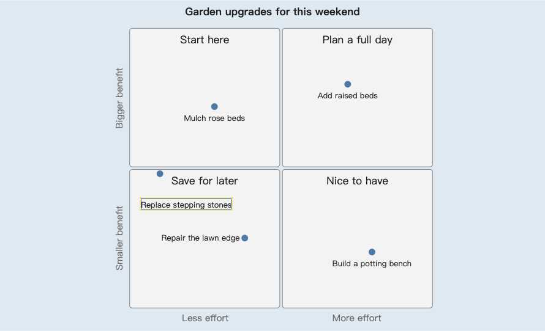

# 给 Pele 生成的 SVG 微调一个标签

[English](PELE.md) · [打开中文版](https://lydiatools.github.io/nudgesvg/?lang=zh)

保留已经生成的图，只调整需要收尾的那个标签。

这张原创的模拟园艺规划图由 **Pele 1.7.0** 渲染。在本机 Chrome 中，“Replace stepping stones” 标签靠近横向分界，并略超出绘图区左边缘。用 NudgeSVG 按绘图坐标向右移 **20**、向下移 **64**，数据点、其他标签和生成样式保持不变。

**调整前：真实编辑器预览**



**调整后：向右 20、向下 64**



图片直接截自实际编辑器预览。蓝色外围和选中轮廓属于界面，不会写入下载的 SVG。

## 直接试用已有文件

1. 把 [garden.original.svg](https://raw.githubusercontent.com/LydiaTools/nudgesvg/main/examples/pele/garden.original.svg) 保存为本地 `.svg` 文件。
2. [打开 NudgeSVG 中文版](https://lydiatools.github.io/nudgesvg/?lang=zh)，点击“打开 SVG”载入文件。
3. 在元素列表选择 **Replace stepping stones**；在 **Δ x** 输入 `20`、**Δ y** 输入 `64`，点击“应用位移”。
4. 查看唯一一处 `transform` 源码改动，再下载 SVG、PNG 或改动 JSON。

可对照[实际调整结果](../examples/pele/garden.adjusted.svg)和[实际改动记录](../examples/pele/garden.changes.json)。记录中的范围和哈希对应这两份精确输入、输出；本例只改一处源码范围，不把整份 SVG 重新序列化。

## 重新生成输入

克隆当前 main 分支，使用 Node.js 20+：

```sh
npm ci --ignore-scripts
npm run test:pele
node scripts/render-pele-example.mjs
```

检查步骤使用锁定的 `pele@1.7.0` 渲染 [garden.mmd](../examples/pele/garden.mmd)，与仓库中的原始 SVG 逐字节比较。最后一条命令生成 `artifacts/pele/garden.svg`，已有同名文件时拒绝覆盖；用 `--out another.svg` 可另选输出文件。

编辑器本身不需要安装 npm 包。v0.1.1 ZIP 已包含此示例与复现脚本；此前的 v0.1.0 Release 保持不变。

## 调整的范围

- 调整对象是导出的**静态 SVG**，不会反写 Mermaid 文本。重新渲染 Mermaid 会得到一份未包含手动位移的新 SVG。
- 本教程只验证这个 Pele 版本和这张图，不代表所有 Pele/Mermaid 图形都可导入或有相同排版、导出效果。
- PNG 按 SVG 栅格化，未绘制图形的区域可能保留透明；请在合适的背景上使用。本机字体也可能影响文字外观。
- NudgeSVG 不加载 Pele 运行库；脚本、外部资源、动画等不支持内容仍会被拒绝。

[Pele #35](https://github.com/obsidianmd/pele/issues/35) 的公开标签位置讨论促成了这次兼容性检查。园艺输入独立编写；本例展示手动收尾方法，没有修改 Pele 排版算法，也不代表获得上游认可。[Pele 许可声明](../examples/pele/PELE-LICENSE.txt)
